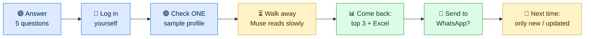
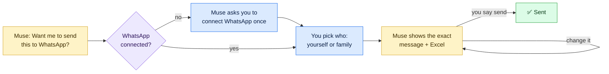

# 💍 Matrimony Match Scout — a skill for Muse


> **Too many matrimony profiles and chats to check one by one?**
> Ask Muse to run the Scout. It reads **your own** matrimony account (for example
> Shaadi.com), compares every profile with what **you** said you want, and gives
> you a short ranked shortlist with a reason for each match — plus an
> **Excel sheet** you can send to family on **WhatsApp**.
> Next time, it shows you **only what's new**.

> [!TIP]
> 🗣️ **Talk in your own language.** Telugu, Hindi, Tamil, Kannada, Malayalam, Marathi, Bengali,
> Gujarati, Punjabi, Urdu, English — or a mix like Hinglish. Muse answers in the same language,
> and reads profiles, chats and call notes in other languages too.

> [!TIP]
> 🟢 **New here?** Read [START-HERE](skills/matrimony_match_scout/START-HERE.md) first — 2 minutes, plain words, with a zero-risk demo on made-up profiles.

---

## 📑 Contents

| | Section | What it tells you |
|---|---|---|
| 🟣 | [What you get](#-what-you-get) | The shortlist, the Excel sheet, WhatsApp, memory |
| 🔵 | [Install](#-install-in-muse-2-minutes) | Three steps in Muse |
| 🟢 | [Your first run](#-your-first-run--start-it-then-walk-away) | What to do, and when you can walk away |
| 🟡 | [How long it takes](#-how-long-it-takes) | Profiles per run and minutes |
| 🟠 | [How your results arrive](#-how-your-results-arrive) | Chat, Excel, WhatsApp |
| 🔴 | [How matches are scored](#-how-matches-are-scored) | Dealbreakers, points, red flags, unknowns |
| 🟤 | [Memory](#-memory--never-the-same-profile-twice) | Why you never see anyone twice |
| 📞 | [After a call](#-after-a-call--summaries-with-consent) | Call summaries, green and red flags — and the consent rules |
| 🗣️ | [Your language](#-talk-in-your-own-language) | Talk to Muse in Telugu, Hindi, Tamil, Hinglish… |
| ⚪ | [Things you can say](#-things-you-can-say) | Plain-English requests |
| 🛡️ | [Privacy & safety](#-privacy--safety) | What it never does |
| ❓ | [Questions & fixes](#-questions--fixes) | Google sign-in, logouts, slow runs |
| 🧑‍💻 | [For developers](#-for-developers) | Layout, tests, releases |

---

## 🟣 What you get

| | You get | In plain words |
|---|---|---|
| 📝 | **A short summary in the chat** | Three parts: 🔵 **Summary** (how many, new / updated / left out) · 🟢 **Match your interests** (the best 3, with *why it fits* and *what is risky*) · 🟠 **Need your attention** (waiting for your reply, red flags, changed profiles, things to check) |
| 📊 | **An Excel sheet** — attached every time | The comprehensive version: three tabs, **Ranked Matches** (with a *Needs attention* column), **Profile Details**, **Updated Since Last Report** (before → now) |
| 📄 | **A full report** — attached | Summary, matches, needs-attention table, ranked list, and every profile in detail |
| 💬 | **WhatsApp, if you want** | Muse asks *"Want me to send this to WhatsApp?"* and sends the shortlist + Excel sheet only after you approve |
| 🧠 | **Memory** | Nobody is shown twice. A profile returns only if it changed — marked **Updated** with what changed |
| ✏️ | **Change your mind any time** | *"change my age range to 26 to 30"* re-scores everyone already read — no browsing again |
| 📞 | **Call summaries** | Tell Muse how a call went (or send a recording, **only if they agreed to be recorded**) and get a summary with green and red flags |
| 🗣️ | **Your language** | Talk in Telugu, Hindi, Tamil, Hinglish or English — Muse answers in the same |
| 🛡️ | **Read-only** | Muse never sends, accepts, declines or shortlists anything on the site without your OK |

Example of what Muse shows you (made-up people):

```text
Done — I read 10 profiles in 9 minutes.

Summary: 8 profile(s) in this report - 7 new, 1 updated; 2 left out by your
must-haves or dealbreakers. 3 match your interests well, 3 need your attention.

MATCH YOUR INTERESTS (top 3):
1. Asha, 27, Seattle - Software Engineer. Score 90/100 (confidence high).
   Why it fits: Lives in Seattle, one of your places; Education (MS) meets your minimum
   Risky or unknown: nothing spotted
2. Priya, 28, Bellevue - Data Analyst. Score 85/100 (confidence high).
3. Divya, 29, San Jose - Product Manager. Score 75/100 (confidence high).

NEED YOUR ATTENTION (3):
- Asha: waiting for your reply (asked about a phone or video call)
- Meera: changed since you last saw it - profession: Analyst -> Manager
- Sneha: red flag - asks for money

The attached Excel sheet and full report have every profile in detail.
📎 report.xlsx   📎 report.md
Tip: after a call with someone on this list, tell me how it went — or, only if they
agreed to be recorded, send me the recording — and I'll add a call summary with
green and red flags. Recording without everyone's consent is illegal in many places.
Want me to send this to WhatsApp?
```

> [!NOTE]
> 🔵 **Short in the chat, complete in the files.** The chat message is a quick summary.
> The attached Excel sheet and full report have **every** profile in the run, with all the details.

---

## 🔵 Install in Muse (2 minutes)

1. 📥 Download the skill: **[matrimony_match_scout-muse-v0.3.6.zip](releases/matrimony_match_scout-muse-v0.3.6.zip)**
2. 📎 Open **Muse**, start a chat, **attach the zip**, and say **"Install this skill for me"**
3. 💬 Start a **new** chat and say **"Run matrimony scout"**

> [!NOTE]
> 🔵 That's all. There is nothing to install on your computer and no commands to learn — you just talk to Muse.

**The first time you run it, Muse opens with a quick summary of everything it can do:**

```text
Welcome to Matrimony Match Scout - here is what I can do for you:

- Shortlist: I read your own matrimony account and rank every profile against what you want.
- Top 3 first: who matches your interests, who needs your attention, and why.
- Excel + full report: attached in the chat every time, ready to share with family.
- WhatsApp: I can send the shortlist and Excel sheet - only after you approve the message.
- Never twice: you never see the same profile again unless it changed (marked Updated).
- Dealbreakers and red flags: dealbreakers rule a profile out; red flags are called out.
- Call summaries: tell me how a call went - or send a recording, only if they agreed.
- Your language: Telugu, Hindi, Tamil, Hinglish, English or another language.
- Safe and private: you log in yourself, I only read, nothing is sent without your OK.
- Time: about 5-10 minutes for 5 profiles - you can leave and come back.

Let's start with 5 quick questions. Or say "show me a demo" to see an example first.
```

Ask *"what can you do?"* any time to see it again.

---

## 🟢 Your first run — start it, then walk away



🔵 **Blue = you do it** (about 3 minutes) · 🟡 **Yellow = Muse works alone** · 🟢 **Green = your results**

| Step | Who | What happens |
|---|---|---|
| 1 | 🔵 You | Say **"Run matrimony scout"** and answer **5 quick questions**: which site, who the search is for, age range, places that are okay, one dealbreaker |
| 2 | 🔵 You | A browser opens on your matrimony site. **Log in yourself** — Muse never sees or stores your password |
| 3 | 🔵 You | Muse shows what it read from **one** profile. Say **"yes"**, or correct it (*"age is 28"*) |
| 4 | 🟡 Muse | Muse tells you how long the run will take — then you can **leave, or close the app** |
| 5 | 🟡 Muse | It reads profiles one by one, like a person, and posts *"5 of 10 read — about 4 minutes left"* |
| 6 | 🟢 You | **Come back later.** Your top 3 is waiting in the chat, with the Excel sheet attached |
| 7 | 🟢 You | Say **"yes"** to WhatsApp if you want to send it to yourself or family |

> [!IMPORTANT]
> 🟣 **Log in with your mobile number + OTP, or email + password.** Google blocks
> *"Sign in with Google"* in assistant-controlled browsers ("This browser or app may not be secure").

> [!NOTE]
> 🔵 Fine-tune later from real examples: education, religion, community, mother tongue, food,
> smoking and drinking, relocation, timeline, red flags and green flags — just say **"refine my criteria"**.

---

## 🟡 How long it takes

Muse reads each profile carefully — opening the page, reading it, saving it —
at about **30–60 seconds per profile**. To keep every run short, the Scout reads
**5 profiles by default** and **at most 10 per run**. Ask for more and it will do more.

| You say | 🟢 / 🟡 / 🔴 | Profiles this run | About how long |
|---|---|---|---|
| *nothing about numbers* | 🟢 default | **5** | **5–10 minutes** |
| *"read 10 this time"* | 🟢 normal max | **10** | **8–15 minutes** |
| *"read 25 this time"* | 🟡 only because you asked | **25** | Muse tells you before it starts |
| *"read 500"* | 🔴 hard ceiling | **50** | the most in one run, to stay gentle on the site |
| *"always do 20"* | 🟡 saved choice | **20** every run | until you change it |

> [!TIP]
> 🟢 Lots of profiles? Several short runs beat one long one. After each shortlist, just say **"read the next 5"** —
> Muse reads profiles it hasn't seen yet first.

---

## 🟠 How your results arrive

Everything comes to you **in the Muse chat** — you never open a folder.

| | What | Details |
|---|---|---|
| 💬 | **The summary message** | 🔵 Summary · 🟢 Match your interests (top 3: why each fits, what's risky or unknown, next step) · 🟠 Need your attention |
| 📊 | **Excel sheet** (`report.xlsx`) — always attached | **Ranked Matches** (rank, score, confidence, age, city, education, profession, why, risks, **needs attention**, judgement, chat, next step, link) · **Profile Details** (every field: height, income, religion, community, mother tongue, food and habits, horoscope, family, about-me…) · **Updated Since Last Report** (field, before, now) |
| 📄 | **Full report** (`report.md`) | Summary → matches → needs-attention table → ranked list → every profile in detail; pasted into the chat if attaching isn't possible |
| 🟢 | **WhatsApp** — only if you say yes | See below |

### 💬 Sending to WhatsApp



1. 🟡 After the report, Muse asks: **"Want me to send this to WhatsApp?"**
2. 🟣 If WhatsApp isn't connected yet, Muse shows you how to **connect WhatsApp to Muse** (one time).
3. 🔵 You say who it goes to — **yourself** or a **family member or group**.
4. 🟡 Muse shows the **exact message** and the **Excel sheet** it will attach, for example:

   ```text
   *Matrimony shortlist - 20 Nov 2026*
   8 profiles (7 new, 1 updated); 3 need attention. Full details in the attached Excel sheet.

   *Match your interests:*
   *1. Asha* (27, Seattle) - 90/100
      + Lives in Seattle, one of your places; Education (MS) meets your minimum
   ...
   _Private - please do not forward further._
   ```
5. 🟢 Nothing is sent until you say **"send"**. Change anything first and Muse shows it again.

> [!WARNING]
> 🟡 A WhatsApp message contains other people's profile details. Send it only to family you trust.
> Once sent, that copy lives in WhatsApp. No WhatsApp connection available? Forward the attached Excel sheet from the chat yourself.

---

## 🔴 How matches are scored

Every profile goes through four steps, always in this order. The same profile and the same wishes always give the same score.

| Step | Colour | What it does |
|---|---|---|
| **1. Must-haves & dealbreakers** | 🔴 | Age range, places, marital status, minimum education, must-match religion / community / mother tongue, height, food and habits you said are not okay, and **your dealbreakers** (smoking, drinking, non-veg, divorced, manglik, children, not willing to relocate…). A known fail **excludes — no exceptions**. |
| **2. Points (0–80)** | 🔵 | Place (city 20 · state 14 · country 8) · education (up to 15) · career (15) · food and habits (5 each) · mother tongue (8), religion (4), community (3) preferred · green flags (+4 each, up to +10). Only what you set **and** the profile shows. |
| **3. Judgement (0–20)** | 🟣 | Muse's short reading of fit and risks: how their own words match what you care about, and how the chat is going — always with a written reason. |
| **4. Red-flag cap** | 🟠 | Any red flag you listed (for example *asks for money*, *pressure to move off the site*) **caps the score at 40** and is named in the risks. |

| Marker | Meaning |
|---|---|
| 🟢 **confidence high** | The profile shows almost everything you care about |
| 🟡 **confidence medium / low** | Some of it isn't shown — see *Unknown - please check* |
| ⚪ **Unknown** | Never counted for or against anyone. Always listed so you can ask. |
| ✅ **Matches your interests** | Score 60+ and no red flag — listed first in the summary |
| ⚠️ **Needs your attention** | Waiting for your reply, red flag, chat contradicts profile, changed since last time, or something you care about isn't shown |
| 🚫 | No face recognition, no photo analysis, no looks scoring — ever |

---

## 🟤 Memory — never the same profile twice

| | Rule |
|---|---|
| 🧠 | Every profile Muse has shown you is logged. **It is never shown again** unless it changed. |
| 🔄 | A changed profile (new job, new chat message…) comes back **once**, marked **Updated**, with *before → now* in the Excel tab |
| 🙅 | Say *"pass on 2"* and that person **never** comes back |
| ✏️ | Change your wishes and everyone already read is **re-scored from saved notes** — no browsing |
| 📝 | Your wishes live in an editable file. Edit it by hand and Muse **notices and asks** before using the change — it never overwrites you silently |
| 💾 | Progress is saved after **every** profile — a dropped connection resumes, never restarts |

---

## 📞 After a call — summaries (with consent)

After you talk to someone on your list, Muse can add a **short call summary** to
their profile: what you talked about, 🟢 **green flags**, 🔴 **red flags**,
promises made ("will share horoscope Sunday"), anything that **contradicts their
profile**, and **patterns** across calls and chats. Muse suggests this after
every report.

> [!CAUTION]
> 🔴 **Consent and the law — read this first.**
> - **Recording a call without the other person's consent is illegal in many places.** In
>   **California**, every person on the call must agree — even when you are on the call yourself
>   (California Penal Code §§ 632 and 632.7). Breaking it can mean fines and even jail time.
> - Rules differ by country and state (including in India). **Always ask before you record**,
>   and check the rules where you and the other person are. This is not legal advice.
> - **If they say no, don't record.** Use the notes option below instead — it needs no consent,
>   because it's only your own words.
> - Muse **never listens to a live call.** If you send a recording, Muse first asks
>   *"Did they agree to be recorded?"* and won't use it unless you say yes.

| Option | 🟢 / 🟡 | How |
|---|---|---|
| **1. Notes after the call** (recommended) | 🟢 no consent needed | Right after the call, tell Muse in your own words — typed or a voice note: *"she asked about my job twice, wouldn't say where she lives…"* |
| **2. A recording** | 🟡 only with their consent | Ask at the start: *"Is it okay if I record this so I remember?"* Then record and send the recording or its transcript to Muse |

**Recording on an iPhone** (iOS 18.1 or later, iPhone XR or newer, some regions):
1. Ask the other person and get a clear **yes**.
2. During the call, tap **More → Call Recording**. Both of you hear an announcement that the call is being recorded.
3. When you hang up, the recording and a transcript are saved in **Notes → Call Recordings**.
4. Share the transcript or audio into your Muse chat and say *"analyse my call with Asha"*.

WhatsApp calls can't be recorded this way. With their agreement, switch to a normal phone call,
or record on a second device with the call on speaker. On Android, some phones have call
recording in the Phone app — it depends on the model and country.

| Muse always | Muse never |
|---|---|
| 🟢 keeps only a short summary (600 characters at most) | 🔴 stores the recording or a transcript — it deletes them after summarising |
| 🟢 bases flags on what was actually said, with a few words of evidence | 🔴 judges voice, accent or tone, or does "lie detection" |
| 🟢 adds call red flags to the score (they cap it at 40) and to *Need your attention* | 🔴 gives psychological or medical labels |

---

## 🗣️ Talk in your own language

Talk to Muse in **your own language** — **Telugu, Hindi, Tamil, Kannada, Malayalam,
Marathi, Bengali, Gujarati, Punjabi, Urdu, English**, or a mix like **Hinglish**.

| | |
|---|---|
| 🟢 | Muse answers in the language you use, and switches when you switch |
| 🟢 | The five questions, your summary, the WhatsApp message and call summaries come in your language |
| 🟢 | Profiles, chats and call notes in other languages are fine — Muse reads them |
| 🟡 | The attached Excel sheet and full report keep **English** column names and headings |

---

## ⚪ Things you can say

| To… | Say |
|---|---|
| Start | *"run matrimony scout"*, *"lets start"* |
| Scan | *"scan"*, *"check my chats"*, *"read 10 this time"*, *"read the next 5"* |
| See time | *"how long will this take?"*, *"how much is left?"* |
| Results | *"give me the report"*, *"give me the excel"*, *"send it to WhatsApp"* |
| Change wishes | *"change my age range to 26 to 30"*, *"add Pune to my places"*, *"my dealbreaker is smoking"*, *"refine my criteria"* |
| Decide | *"interested in Asha"*, *"pass on 2"*, *"why is 1 ranked first"*, *"draft a reply to Asha"* |
| Check | *"check status"*, *"what did you show me before"* |
| Files | attach biodata PDFs, Word files, screenshots, chat exports or broker spreadsheets and say *"read my files"* |
| Privacy | *"how do you read my data?"*, *"delete all my scout data"* |
| After a call | *"here are my notes from the call with Asha"*, or send a recording **(only with their consent)** |
| Try it | *"show me a matrimony scout demo"* |

> [!TIP]
> 🗣️ These are just examples — say the same things in your own language.

---

## 🛡️ Privacy & safety

> [!CAUTION]
> 🔴 **Things the Scout never does:**
> - ❌ ask for, see, type or store your password or one-time codes
> - ❌ send, accept, decline or shortlist anything on the site — or send anything on WhatsApp — without your approval of the exact message and recipient
> - ❌ copy your conversations (chats become a one-line summary)
> - ❌ store phone numbers or email addresses from profiles or spreadsheets
> - ❌ use face recognition or judge photos or looks
> - ❌ listen to a live call, use a recording the other person didn't agree to, or keep any recording or transcript
> - ❌ upload your data anywhere, or browse fast — one profile at a time, small caps

| | Where your data lives |
|---|---|
| 🔒 | The Scout's notes are in its own **private folder in your Muse workspace** — your wishes, the profiles read, what you were shown, and reports |
| 💬 | Reports reach you **in the chat**. Sharing (WhatsApp or forwarding) is always your choice |
| 🗑️ | Say **"delete all my scout data"** — after you confirm, everything is gone |

Details: [PRIVACY.md](PRIVACY.md) · [SECURITY.md](SECURITY.md)

---

## ❓ Questions & fixes

| You see | 🟢 What to do |
|---|---|
| 🔴 *"Couldn't sign you in — this browser or app may not be secure"* | That's Google. Log in to Shaadi with **mobile number + OTP** or **email + password** instead of *Sign in with Google* |
| 🟡 *"The site logged you out after 7 profiles"* | Log in again in the browser and say **"carry on"** — nothing read is lost |
| 🟡 *"10 is the most per run unless you ask for more"* | Say **"read 20 this time"** (up to 50) |
| 🟡 It's slow | That's on purpose: careful, person-like reading. Start it and come back later, or do **"read the next 5"** runs |
| ⚪ *"Nothing new since your last report"* | Everyone has already been shown to you. Say **"scan"** later to look for new profiles |
| ⚪ *"None of the new profiles pass your must-haves"* | Loosen one thing, e.g. *"change my age range to 25 to 32"* |
| 🟣 WhatsApp isn't offered | Connect WhatsApp in Muse when asked — or forward the attached Excel sheet from the chat |
| 🟤 A field was read wrong | Correct it during the one-profile check (*"education is MBA"*) |

---

## 🧑‍💻 For developers

```text
skills/matrimony_match_scout/
├── SKILL.md            ← what Muse follows, step by step
├── START-HERE.md       ← plain-words guide for the person
├── references/         ← intake, login, site playbooks (Shaadi, generic), schema,
│                         scoring rubric, file reading, memory, conversation map
├── scripts/            ← scout.py (the actions Muse calls), state_store, score,
│                         extract, pipeline, build_report (Excel/Markdown),
│                         timing (estimates), file_intake
├── templates/          ← every interests setting, with defaults
├── examples/           ← fictional profiles for the demo
└── tests/              ← 65 tests, fictional data only
```

```bash
python3 -m pip install -r requirements.txt                          # openpyxl (+ pypdf, optional)
python3 -m unittest discover -s skills/matrimony_match_scout/tests  # run the tests
python3 tools/build_release.py                                      # build the Muse zip in releases/
```

Changes: [CHANGELOG.md](CHANGELOG.md) · Releasing: [PUBLISH.md](PUBLISH.md)

---

## 📜 License

Copyright © 2026 Vishnu. **All rights reserved.** You may download and run the
Scout for your own search; no copying, redistributing or selling without
written permission. See [LICENSING.md](LICENSING.md).
