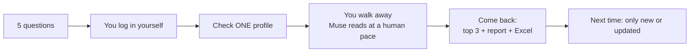

# Matrimony Match Scout — a skill for Muse

> **Too many matrimony profiles and chats to check one by one?**
> Ask Muse to run the Scout. It reads your own account, ranks the best
> matches against what *you* said you want, and next time shows you
> **only what's new**.

> [!TIP]
> **New here?** Read [START-HERE](skills/matrimony_match_scout/START-HERE.md) first — 2 minutes, plain words.

## ✨ What you get

- 🎯 **Your top 3 first**, in plain English — why each fits, what's risky or unknown
- 📊 **A report + Excel sheet** (Ranked Matches / Profile Details / Updated Since Last Report) to share with family
- 🧠 **Memory** — a profile is never shown twice; it returns only if it changed, marked *Updated*
- ✏️ **Change your mind any time** — "change my age range to 26 to 30" re-scores everything without browsing again
- 🛡️ **Read-only** — Muse never sends, accepts or rejects anything without your OK

## 🚀 Install in Muse (2 minutes)

1. Download the [skill zip](releases/matrimony_match_scout-muse-v0.3.2.zip)
2. Open Muse, start a chat, **attach the zip**, and say **"Install this skill for me"**
3. Start a **new** chat and say **"Run matrimony scout"**

## ⏳ Start it, then walk away

Muse reads your profiles the way a careful person would — one at a time,
opening each page and reading it. **That takes a while: about 30–60 seconds
per profile.** So each run reads **5 profiles by default (about 5–10 minutes)**
and **at most 10 (about 8–15 minutes)** — say "read 20 this time" if you want
more. Muse tells you the estimate before it starts and the time left as it goes.

You don't need to sit and watch:

1. Say **"Run matrimony scout"** and answer **5 quick questions**.
2. When the browser opens, **log in to your matrimony site yourself**.
   (Use mobile number + OTP or email + password — Google blocks
   "Sign in with Google" in assistant-controlled browsers.)
3. Check the **one sample profile** Muse shows you and say "yes" (or correct it).
4. Say **"Go ahead and run the scout"** — then **leave, or close the app**.
5. **Come back later.** Your top 3, the report and the Excel sheet will be waiting.

> [!NOTE]
> Lots of profiles? Run the Scout a few times — say **"read the next 5"** after
> each shortlist. Short runs give you results sooner. If anything needs you (the site logs you out or
> shows a check), Muse saves its place and leaves you a one-line note; say
> **"carry on"** when you're back.

## 🔁 How it works

1. **Hard filters first** — your dealbreakers exclude, no exceptions. Then a weighted score plus Muse's short judgement on fit and risks.
2. **Unknowns stay unknown** — never assumed to pass or fail, always shown so you can check.
3. **Any red flag you listed** (like "asks for money") caps the score.

**Things you can say:** "check status" · "how much is left?" · "give me the report" ·
"read 10 this time" · "read the next 5" · "change my age range to 26 to 30" · "pass on 2" · "interested in Asha" ·
"why is 1 ranked first" · "draft a reply to Asha" · "what did you show me before"

## 🔒 Privacy

Everything stays in one folder on your laptop (`~/matrimony-scout-data`). You
log in yourself — your password is never seen or stored. Chats are kept as
short summaries, never copies. No face recognition, no looks scoring. Delete
the folder and it's all gone. Details: [PRIVACY.md](PRIVACY.md) · [SECURITY.md](SECURITY.md)

## License

Copyright © 2026 Vishnu. All rights reserved. You may download and run the
Scout for your own search; no copying, redistributing or selling without
written permission. See [LICENSING.md](LICENSING.md).
