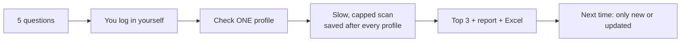

# Matrimony Match Scout


> **Too many matrimony profiles and chats to check one by one?**
> The Scout reads your own account, ranks the best matches against what
> *you* said you want, and next time shows you **only what's new**.

> [!TIP]
> **New here?** Read [START-HERE](skills/matrimony_match_scout/START-HERE.md) first — 2 minutes, plain words.

## ✨ What you get

- 🎯 **Your top 3 first**, in plain English — why each fits, what's risky or unknown
- 📊 **A Markdown report + Excel sheet** (Ranked Matches / Profile Details / Updated Since Last Report) to share with family
- 🧠 **Memory** — a profile is never shown twice; it returns only if it changed, marked *Updated*
- ✏️ **Change your mind any time** — "change my age range to 26 to 30" re-scores everything without re-browsing
- 🛡️ **Read-only** — nothing is sent, accepted or rejected without your OK

## 🚀 Install — pick one

### Option 1 — Terminal

Needs Python 3.10+.

```bash
git clone https://github.com/MakeLifesBetter/MatrimonyMatchScoutAIAgent.git
cd MatrimonyMatchScoutAIAgent
python3 -m pip install -r requirements.txt
python3 -m playwright install chromium
python3 skills/matrimony_match_scout/scripts/scout.py
```

Then just talk: **"lets start"** → 5 questions → **"scan"** opens your site,
you log in yourself, press **Enter**, and the Scout does the rest.
No git? Use **Code → Download ZIP**, unzip, and run the last three lines inside the folder.

### Option 2 — AI app (Muse)

1. Download the [skill zip](releases/matrimony_match_scout-muse-v0.2.0.zip)
2. In Muse, start a chat, **attach the zip**, and say **"Install this skill for me"**
3. In a **new** chat say **"Run matrimony scout"** — Muse opens the browser, you log in, it scans and scores

## 🔁 How it works



1. **Hard filters first** — your dealbreakers exclude, no exceptions. Then a weighted score plus a short judgement.
2. **Unknowns stay unknown** — never assumed to pass or fail, always shown so you can check.
3. **Any red flag you listed** (like "asks for money") caps the score.

## 🔒 Privacy

Everything stays in one folder on your laptop (`~/matrimony-scout-data`). Your
password is never seen or stored. Chats are kept as short summaries, never
copies. No face recognition, no looks scoring. Delete the folder and it's all
gone. Details: [PRIVACY.md](PRIVACY.md) · [SECURITY.md](SECURITY.md)

## License

Copyright © 2026 Vishnu. All rights reserved. You may download and run the
Scout for your own search; no copying, redistributing or selling without
written permission. See [LICENSING.md](LICENSING.md).
