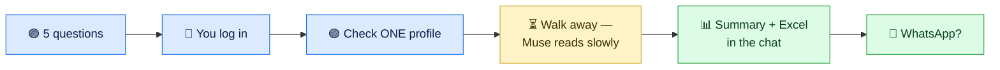

# 💍 Matrimony Match Scout — a skill for Muse


**Muse reads your own matrimony account (for example Shaadi.com), compares every
profile with what you want, and gives you a short ranked shortlist — with the
reasons, the risks, an Excel sheet for family, and only what's new next time.**

[Features](#-all-features-at-a-glance) · [Install](#-install-in-muse) · [How a run works](#-how-a-run-works) · [What you get](#-what-you-get-back) · [Scoring](#-how-scoring-works) · [Calls](#-call-summaries--consent-first) · [Say it your way](#-things-you-can-say) · [Privacy](#-privacy--safety) · [Fixes](#-questions--fixes)

> [!TIP]
> 🟢 **New here?** Read [START-HERE](skills/matrimony_match_scout/START-HERE.md) — 2 minutes, plain words.
> Or say **"show me a matrimony scout demo"** in Muse to see a full example on made-up profiles.

---

## ✨ All features at a glance

### 🟣 Getting started
- **Welcome summary** — the first time, Muse lists everything it can do; ask *"what can you do?"* any time.
- **5 quick questions** — site, who it's for, age range, places, one dealbreaker. Nothing else needed to start.
- **Refine later from real examples** — education, religion, community, mother tongue, food, smoking, drinking, relocation, timeline, red flags, green flags.
- **Change your mind in plain words** — *"change my age range to 26 to 30"*; everyone already read is re-scored instantly, no browsing.
- **Demo** — a complete example on fictional profiles before you log in anywhere.

### 🔵 Finding profiles
- **Reads your own account** — chats, interests received, matches and search results, after you log in yourself.
- **One-profile check first** — Muse shows what it read from one profile so you can correct it before the full run.
- **Reads unseen profiles first** — *"read the next 5"* picks up where you left off.
- **Your files too** — biodata (PDF, Word, text), profile screenshots, chat exports and broker spreadsheets (CSV, Excel).
- **Every detail that's shown** — name, age, height, city, education, job, employer, income, religion, community, mother tongue, marital status, food, smoking, drinking, children, relocation, family, about-me, partner preference, horoscope.
- **Chats as short notes** — who wrote first and last, what it was about, questions still open. Never a copy.

### 🔴 Scoring
- **Dealbreakers rule out — no exceptions** — smoking, drinking, non-veg, divorced, manglik, children, not willing to relocate, or your own words.
- **Points for what you care about** — place, education, career, food and habits, language, religion, community, green flags.
- **Muse's judgement** — a short written reading of fit and risks for each profile.
- **Red flags cap the score at 40** — like *asks for money* or *pressure to move off the site*.
- **Unknown stays unknown** — never counted for or against anyone; always listed for you to check.
- **Confidence level** — high, medium or low, by how much of what you care about the profile shows.

### 🟢 Your results
- **Three-part summary in the chat** — 🔵 Summary · ✅ Match your interests (top 3) · ⚠️ Need your attention.
- **Excel sheet, attached every time** — Ranked Matches · Profile Details · Updated Since Last Report.
- **Full report, attached** — every profile in the run, in detail.
- **WhatsApp** — sends the shortlist + Excel sheet to you or family, only after you approve the exact message.
- **"Why is 1 ranked first?"** — points, judgement and risks explained.
- **Reply drafts** — Muse drafts; you approve the exact text before anything is sent.
- **History** — *"what did you show me before?"*

### 🟤 Memory
- **Never the same profile twice** — it returns only if it changed, marked **Updated** with *before → now*.
- **Pass means gone** — *"pass on 2"* and that person never comes back.
- **Saves after every profile** — a dropped connection or a logout resumes; nothing is read twice.
- **Deleted profiles drop out** — profiles removed from the site don't appear in reports.
- **Your interests file is yours** — edit it by hand and Muse notices and asks before using the change.

### 📞 Calls
- **Call summaries** — tell Muse how a call went, or send a recording **only if the other person agreed**, and get green flags, red flags, promises and contradictions.
- **Patterns over time** — compared with earlier calls and chats with the same person.

### 🟡 Time & control
- **Know how long** — an estimate before it starts and *"5 of 10 read — about 4 minutes left"* as it goes.
- **Short runs** — 5 profiles by default, 10 at most per run, more only when you ask (never more than 50).
- **Walk away** — after the one-profile check, Muse finishes on its own; come back to the results.
- **Stop any time** — say *"stop"*; say *"carry on"* later.

### 🗣️ Your language
- **Talk in your own language** — Telugu, Hindi, Tamil, Kannada, Malayalam, Marathi, Bengali, Gujarati, Punjabi, Urdu, English, or a mix like Hinglish. Muse answers in the same, and reads profiles, chats and call notes in other languages.

### 🛡️ Safe & private
- **You log in yourself** — your password is never seen or stored.
- **Read-only** — nothing is sent, accepted, declined or shortlisted without your OK.
- **No face recognition, no looks scoring** — photos are never used.
- **Private notes** — kept in the Scout's own folder in your Muse workspace; *"delete all my scout data"* removes everything.

---

## 🔵 Install in Muse

1. 📥 Download **[matrimony_match_scout-muse-v0.3.7.zip](releases/matrimony_match_scout-muse-v0.3.7.zip)**
2. 📎 In **Muse**, start a chat, **attach the zip**, and say **"Install this skill for me"**
3. 💬 Start a **new** chat and say **"Run matrimony scout"**

Nothing to install on your computer, no commands to learn. Muse opens with a short welcome listing what it can do, then asks the 5 questions.

---

## 🟢 How a run works



🔵 **You** (about 3 minutes) · 🟡 **Muse on its own** · 🟢 **Your results**

1. 🔵 Say **"Run matrimony scout"** and answer the **5 questions**.
2. 🔵 A browser opens on your matrimony site — **log in yourself**.
3. 🔵 Check the **one profile** Muse read — say **"yes"** or correct it (*"age is 28"*).
4. 🟡 Muse tells you **how long** it will take. **Leave, or close the app.**
5. 🟡 Muse reads one profile at a time and posts the **time left**.
6. 🟢 **Come back** to the summary and the attached Excel sheet. Say **"yes"** to WhatsApp if you want.

> [!IMPORTANT]
> 🟣 **Log in with mobile number + OTP, or email + password.** Google blocks *"Sign in with Google"*
> in assistant-controlled browsers (*"This browser or app may not be secure"*).

### ⏳ How long it takes

Muse reads carefully, like a person — about **30–60 seconds per profile**.

| You say | Profiles this run | About how long |
|---|---|---|
| 🟢 *nothing* | **5** (default) | **5–10 minutes** |
| 🟢 *"read 10 this time"* | **10** (most per run) | **8–15 minutes** |
| 🟡 *"read 25 this time"* | **25** — only because you asked | told before it starts |
| 🔴 *"read 500"* | **50** — the hard ceiling | told before it starts |
| 🟡 *"always do 20"* | **20** every run | until you change it |

> [!TIP]
> 🟢 Many profiles? Several short runs beat one long one — say **"read the next 5"** after each summary.

---

## 🟢 What you get back

Everything arrives **in the Muse chat**. Short in the message, complete in the files.

**1. 💬 The summary** (made-up people):

```text
Done — I read 10 profiles in 9 minutes.

Summary: 8 profile(s) in this report - 7 new, 1 updated; 2 left out by your
must-haves or dealbreakers. 3 match your interests well, 3 need your attention.

MATCH YOUR INTERESTS (top 3):
1. Asha, 27, Seattle - Software Engineer. Score 90/100 (confidence high).
   Why it fits: Lives in Seattle, one of your places; Education (MS) meets your minimum
   Risky or unknown: nothing spotted
2. Priya, 28, Bellevue - Data Analyst. Score 85/100 (confidence high).
3. Divya, 29, San Jose - Product Manager. Score 75/100 (confidence high).

NEED YOUR ATTENTION (3):
- Asha: waiting for your reply (asked about a phone or video call)
- Meera: changed since you last saw it - profession: Analyst -> Manager
- Sneha: red flag - asks for money

📎 report.xlsx   📎 report.md
Want me to send this to WhatsApp?
```

**2. 📊 The Excel sheet** — attached every time:

| Tab | What's in it |
|---|---|
| **Ranked Matches** | rank, score, confidence, age, city, education, profession, why it fits, risks, **needs attention**, judgement, chat, next step, link |
| **Profile Details** | every detail read — height, income, religion, community, mother tongue, food and habits, horoscope, family, about-me, calls |
| **Updated Since Last Report** | what changed: field, before, now |

**3. 📄 The full report** — summary, matches, needs-attention table, then every profile in detail.

**4. 💬 WhatsApp** — only if you say yes:

| Step | |
|---|---|
| 1 | Muse asks *"Want me to send this to WhatsApp?"* |
| 2 | Not connected yet? Muse asks you to **connect WhatsApp** to Muse (once) |
| 3 | You say who it goes to — **yourself** or **family** |
| 4 | Muse shows the **exact message** + the **Excel sheet** |
| 5 | Sent only when you say **"send"** |

> [!WARNING]
> 🟡 The message contains other people's profile details — send it only to family you trust. No WhatsApp
> connection? Forward the attached Excel sheet from the chat yourself.

---

## 🔴 How scoring works

Always in this order. The same profile and the same wishes always give the same score.

| | Step | What happens |
|---|---|---|
| 🔴 | **1. Must-haves & dealbreakers** | A known fail on age, places, marital status, education, must-match religion / community / mother tongue, height, food or habits — or any dealbreaker — **excludes the profile** |
| 🔵 | **2. Points, up to 80** | Place (city 20 · state 14 · country 8), education 15, career 15, food and habits 5 each, mother tongue 8, religion 4, community 3, green flags up to +10 — only what you set **and** the profile shows |
| 🟣 | **3. Judgement, up to 20** | Muse's reading of how their own words and chats fit what you care about — with a written reason |
| 🟠 | **4. Red-flag cap** | Any red flag (chat, profile or call) **caps the score at 40** |

| Label | Meaning |
|---|---|
| ✅ **Matches your interests** | score 60+ and no red flag |
| ⚠️ **Needs your attention** | waiting for your reply · red flag · chat or call contradicts the profile · changed since last time · a promise from a call · something you care about isn't shown |
| ⚪ **Unknown** | not shown on the profile — never counted for or against, always listed |
| 🟢 / 🟡 **Confidence** | how much of what you care about the profile shows |

---

## 📞 Call summaries — consent first

After a call, Muse can add a short summary to that person: topics, 🟢 green flags, 🔴 red flags,
promises (*"will share horoscope Sunday"*), contradictions with their profile, and patterns over time.
Muse suggests this after every report.

> [!CAUTION]
> 🔴 **Consent and the law**
> - **Recording a call without the other person's consent is illegal in many places.** In **California**
>   every person on the call must agree — even if you are on the call yourself (Penal Code §§ 632, 632.7).
>   Breaking it can mean fines and jail time.
> - Rules differ by country and state, including in India. **Always ask before recording.** Not legal advice.
> - **If they say no, don't record** — use notes instead.
> - Muse **never listens to a live call**, asks *"Did they agree to be recorded?"* before using a recording,
>   keeps only a short summary, and **deletes the recording and transcript**.

| Option | How |
|---|---|
| 🟢 **Notes** — no consent needed | Right after the call, tell Muse in your own words (typed or a voice note) |
| 🟡 **Recording** — only with consent | Ask first: *"Is it okay if I record this so I remember?"* Then send the recording or transcript |

**iPhone** (iOS 18.1+, iPhone XR or newer, some regions): get a clear yes → during the call tap
**More → Call Recording** (both of you hear an announcement) → after the call, find it in
**Notes → Call Recordings** → share it into Muse and say *"analyse my call with Asha"*.
**WhatsApp calls** can't be recorded this way — with their agreement, switch to a phone call or record
on a second device on speaker.

Muse never judges voice, accent or tone, never does "lie detection", and never gives psychological labels.

---

## 💬 Things you can say

| To… | Say |
|---|---|
| Start | *"run matrimony scout"* · *"what can you do?"* · *"show me a matrimony scout demo"* |
| Read profiles | *"scan"* · *"check my chats"* · *"read 10 this time"* · *"read the next 5"* · *"stop"* · *"carry on"* |
| Time | *"how long will this take?"* · *"how much is left?"* |
| Results | *"give me the report"* · *"give me the excel"* · *"send it to WhatsApp"* |
| Change wishes | *"change my age range to 26 to 30"* · *"add Pune to my places"* · *"my dealbreaker is smoking"* · *"refine my criteria"* |
| Decide | *"interested in Asha"* · *"pass on 2"* · *"why is 1 ranked first"* · *"draft a reply to Asha"* |
| Look back | *"check status"* · *"what did you show me before"* |
| Files | attach biodata, screenshots, chat exports or broker sheets → *"read my files"* |
| Calls | *"here are my notes from the call with Asha"* · send a recording **only with their consent** |
| Privacy | *"how do you read my data?"* · *"forget Asha"* · *"delete all my scout data"* |

> [!TIP]
> 🗣️ **Say it in your own language** — Telugu, Hindi, Tamil, Kannada, Malayalam, Marathi, Bengali,
> Gujarati, Punjabi, Urdu, English or Hinglish. Muse answers in the same. (The Excel sheet keeps English column names.)

---

## 🛡️ Privacy & safety

> [!CAUTION]
> 🔴 **The Scout never:**
> - ❌ asks for, sees or stores your password or one-time codes
> - ❌ sends, accepts, declines or shortlists anything — on the site or WhatsApp — without your OK on the exact message and recipient
> - ❌ copies your conversations — chats and calls become short summaries
> - ❌ stores phone numbers or email addresses
> - ❌ uses face recognition or judges photos or looks
> - ❌ listens to live calls, or uses or keeps a recording the other person didn't agree to
> - ❌ uploads your data anywhere, or browses fast — one profile at a time, small runs

- 🔒 **Where your data lives:** the Scout's own private folder in your Muse workspace — your wishes, profile notes, what you were shown, and reports.
- 💬 **Sharing** is always your choice — reports reach you in the chat.
- 🗑️ **Deleting:** *"forget Asha"* removes one person; *"delete all my scout data"* removes everything, after you confirm.

Details: [PRIVACY.md](PRIVACY.md) · [SECURITY.md](SECURITY.md)

---

## ❓ Questions & fixes

| You see | What to do |
|---|---|
| 🔴 *"Couldn't sign you in — this browser or app may not be secure"* | That's Google. Log in to Shaadi with **mobile + OTP** or **email + password** |
| 🟡 *"The site logged you out after 7 profiles"* | Log in again and say **"carry on"** — nothing read is lost |
| 🟡 *"10 is the most per run unless you ask for more"* | Say **"read 20 this time"** (up to 50) |
| 🟡 It's slow | On purpose — careful, person-like reading. Start it and come back later |
| ⚪ *"Nothing new since your last report"* | Everyone was already shown to you. Say **"scan"** later |
| ⚪ *"None of the new profiles pass your must-haves"* | Loosen one thing — *"change my age range to 25 to 32"* |
| 🟣 WhatsApp isn't offered | Connect WhatsApp in Muse when asked, or forward the attached Excel sheet |
| 🟤 A detail was read wrong | Correct it at the one-profile check — *"education is MBA"* |

---

## 🧑‍💻 For developers

```text
skills/matrimony_match_scout/
├── SKILL.md         what Muse follows, step by step
├── START-HERE.md    plain-words guide for the person
├── references/      intake, login, site playbooks (Shaadi, generic), extraction schema,
│                    scoring rubric, file reading, call notes, memory, conversation map
├── scripts/         scout.py (the actions Muse calls), state_store, score, extract,
│                    pipeline, build_report (Excel + report), timing, file_intake
├── templates/       every interests setting, with defaults
├── examples/        fictional profiles for the demo
└── tests/           65 tests, fictional data only
```

```bash
python3 -m pip install -r requirements.txt                          # openpyxl (+ pypdf, optional)
python3 -m unittest discover -s skills/matrimony_match_scout/tests  # run the tests
python3 tools/build_release.py                                      # build the Muse zip in releases/
```

[CHANGELOG](CHANGELOG.md) · [Releasing](PUBLISH.md)

---

## 📜 License

Copyright © 2026 Vishnu. **All rights reserved.** You may download and run the Scout for your own
search; no copying, redistributing or selling without written permission. See [LICENSING.md](LICENSING.md).
